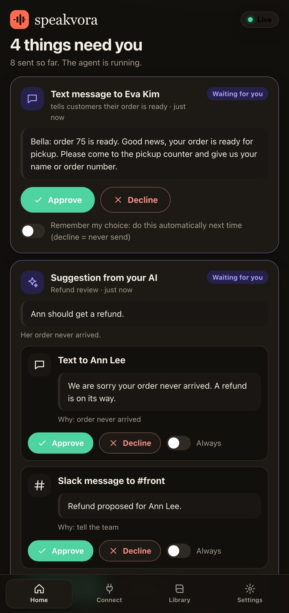
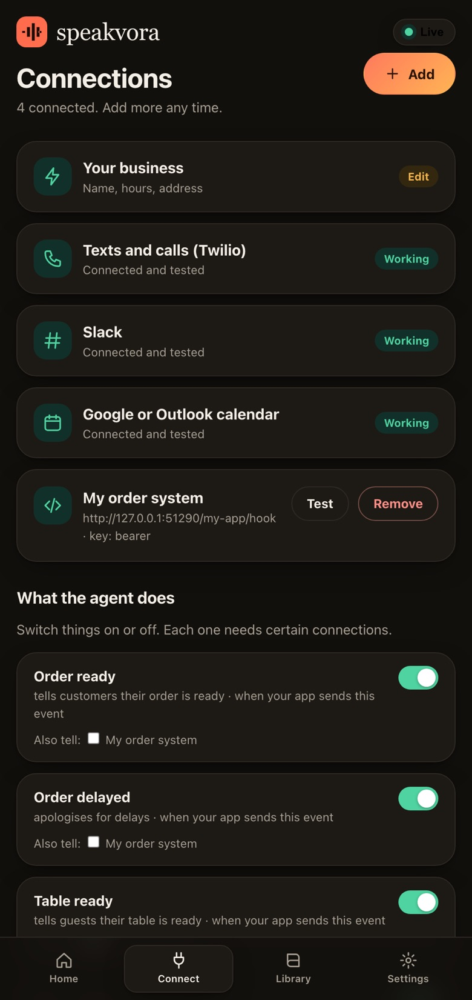
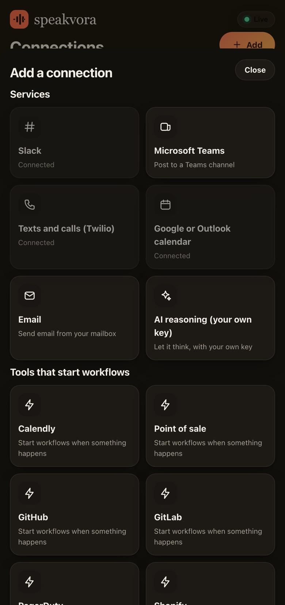
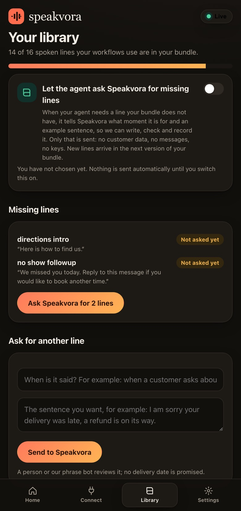

# speakvora-pack-agent

A small agent that turns an offline voice pack into automated work: confirm bookings, remind people from your calendar, tell customers an order is ready, answer texts, calls and email, wake your on-call engineer when a pipeline fails, and tell your team in Slack or Teams.

It runs on **your own server**, next to your app, with **your own accounts**. Standard-library Python only. No per-message fee from us and nothing to install in your chat or calendar. Optional extras use your Speakvora account and are off until you switch them on: hosted order tracking pages, voicing new phrases, and asking for missing lines. Start with [docs/overview.md](docs/overview.md).

> Speakvora sells offline voice packs (audio you ship once). Every full pack in the 12 pack languages includes this agent (see the latest release on the Releases page), so a purchase is audio plus agent for one price. The agent is free software (MIT) and works with any set of audio files laid out like a pack; the pack audio is licensed separately.

## See it first
**Live demo in your browser, nothing to install:** https://speakvora.com/#demo . A made-up clinic's app on one side and the dashboard this agent ships with on the other. Tap an action, switch the internet off, tap again, and watch sends wait in a queue and go out in order when the connection returns.

| Home: approve, decline or automate | Connect: your tools, tested |
|---|---|
|  |  |
| **+ Add: any app by API key or webhook** | **Library: ask for missing phrases** |
|  |  |

(Screenshots use demo data from a made-up business.)

## Try it in two minutes, no accounts

```bash
git clone https://github.com/eyeguide-dev/speakvora-pack-agent && cd speakvora-pack-agent
python3 examples/restaurant/demo.py
```
Or, in any unzipped bundle (or the restaurant sample on the releases page): `./sv-agent demo`, which shows the text it would send and plays the recorded line.
It runs a restaurant's day against fake Twilio, Slack and Google servers on your machine and prints what the agent did, and what it refused to do (no consent, opted out).

## Use it with a pack

```bash
pip install speakvora-pack-agent        # once published on PyPI; until then clone this repo (the demo needs nothing else)
cd your-unzipped-pack
speakvora-pack-agent init --pack .      # writes agent.json + workflows.json for the pack's industry
speakvora-pack-agent check              # what is connected, which spoken lines are missing
speakvora-pack-agent source add github  # ready webhook mappings: github, gitlab, pagerduty, stripe, shopify, calendly, generic-pos
speakvora-pack-agent run                # DRY RUN: records what it would do, sends nothing
speakvora-pack-agent run --live         # when the log looks right
```

## What it connects to

New here? Start with [docs/integrate-in-10-minutes.md](docs/integrate-in-10-minutes.md): `init`, `doctor`, `events` (copy-paste signed examples for Python, Node, PHP, Ruby, Go, curl). Works in all 12 pack languages; `init --mode open` removes per-person and hourly limits (opt-outs, required notices and the kill switch stay on).

Texts, calls and WhatsApp through Twilio, or any provider's web API (`sms_provider`, `call_provider`); Slack and Microsoft Teams; Google Calendar and Microsoft 365 (ICS link or OAuth); SMTP and IMAP email; any system that sends a webhook (a short mapping, no code); any REST API (`http` action). See [docs/connect-anything.md](docs/connect-anything.md) and [docs/integrate-existing-numbers.md](docs/integrate-existing-numbers.md).

**When the internet goes away:** texts, calls, Slack and Teams posts, email, calendar entries and webhooks wait in an outbox on disk and go out in order when the connection returns (safety checks run again at send time; old actions expire; a timeout is never retried, so nothing is sent twice). See [docs/offline-and-queue.md](docs/offline-and-queue.md).

**You do not need a developer to set it up.** Run the agent and open the dashboard it prints: the Connect tab walks you through Slack (with a ready-made app manifest), Microsoft Teams, Google or Outlook calendar, texts and calls (Twilio), email and AI reasoning with your own key, with Test buttons that say in plain words what to fix, workflow switches, and a go-live checklist. Keys are kept in a private file on your machine. See [docs/connect-dashboard.md](docs/connect-dashboard.md).

**Every send is written down first, and there is a small local dashboard.** Each text, call, post, email, calendar entry or webhook becomes a job before it is sent (pending, sending, queued, sent, delivered, needs review, failed, blocked, expired, cancelled), so a crash never loses or repeats one, and a send we cannot be sure about waits for a person instead of being retried. Run the agent and open the address it prints (`/dashboard`): filter what was sent, see what needs you, cancel or send again, check how complete your bundle is and ask for more lines. See [docs/jobs-and-recovery.md](docs/jobs-and-recovery.md) and [docs/dashboard.md](docs/dashboard.md).

**Optional reasoning with your own AI key.** For requests the rules cannot handle ("review these conversations and decide who needs a refund"), a workflow can add a `reason` step that asks a model you choose: any OpenAI-compatible endpoint (a local one such as Ollama keeps it fully offline) or Anthropic. Only the inputs the workflow chooses are sent, with emails, phone numbers and card numbers redacted. The model only proposes; proposals wait in the dashboard with the reasoning and what was sent, and run as normal journaled sends only after a person approves. You pay your own provider; we charge nothing. See [docs/reasoning.md](docs/reasoning.md) and [examples/refund-review](examples/refund-review).

## What is new (see CHANGELOG.md for every release)
* A smarter AI: it learns your business (you review it), works inside limits you set, and cannot refund, charge or delete. A caller can always reach a person.
* Add your own phrases in the dashboard, let your AI suggest more, and let repeated AI lines become instant library lines.
* A phone menu people can speak to, with emergencies and secrets handled, for every industry; service-business follow-ups with tasks for your team.
* Order, visit, repair and request tracking links (restaurants, retail, laundry, pharmacy, home services, auto repair, support): one text, a private page that follows the order, saved in an Orders tab. Optional, hosted by Speakvora, set up with a one-time code from your account.
* Health and other private details only from your own verified system, plus industry rules and a draft call-handling controls catalog for 23 industries.
* Customer details removed from this computer after the days you choose; several business locations in one dashboard.

## Safety is on by default
Dry-run first. Customer messages need consent. STOP is always honoured. Quiet hours and limits (`strict`, `standard`, `open`). Notices your industry must say are added automatically (automated-call line, opt-out footer, emergency and privacy for health, facility notices, debt-collector notice, confidentiality). Signed requests only. A kill switch (create a file named `STOP` in `agent-state/`). See [docs/safety.md](docs/safety.md) and [docs/limits-and-control.md](docs/limits-and-control.md).

## Honest limits
Keyword and menu based, not a chatbot. You run it (Python 3.9+). US texting needs carrier registration in your provider account; inbound phone menus need Twilio. Tested against simulated services, so start in dry-run with your own accounts. Legal notice wording is a starting point for your counsel, not legal advice. Not for medical advice, emergencies or patient information. Not an inmate calling platform.

## License
MIT for the software. Logos or brand names mentioned belong to their owners; no endorsement implied. Pack audio is separate.
