# Connect Shopify and GitHub (step by step, with screenshots)

Shopify and GitHub do not need a developer. You paste **one address** into them, they send events to your agent, and your workflows start. Every screenshot below is a real screen; the address and secret values in them are **fake examples** (marked EXAMPLE) and are not valid. Your own dashboard shows your real ones.

Before you start: your agent needs a public address that Shopify and GitHub can reach (a tunnel such as Cloudflare, or your server). See [setup-services.md](setup-services.md). The agent stays in practice mode until you press Go live, so nothing is sent to your customers while you test.

## Shopify

1. In the agent dashboard open **Connect**, then **Shopify**. Copy **Your address**.

   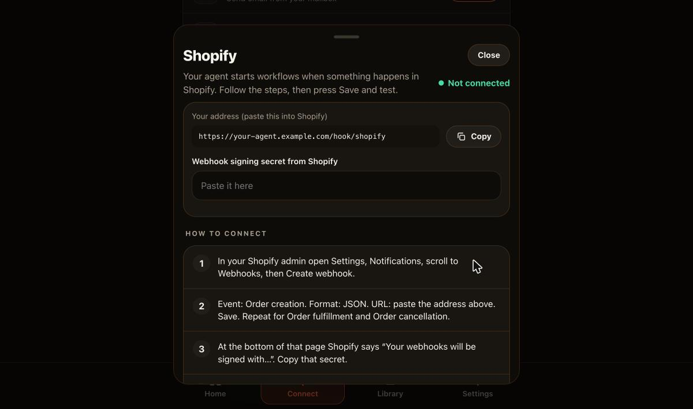

2. In your Shopify admin open **Settings, Notifications**, scroll to **Webhooks**. Shopify shows the line "Your webhooks will be signed with ...". **Copy that secret**; you will paste it into the dashboard in step 5.

   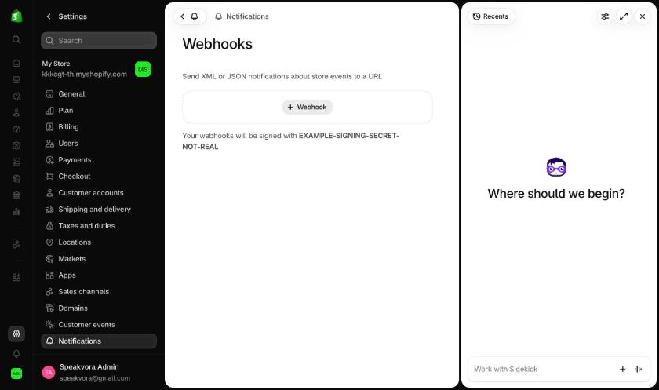

3. Press **Webhook**. Choose the **Event** (for example Order creation), leave **Format** on JSON, paste your agent address into **URL**, press **Save**. Repeat for Order fulfillment and Order cancellation.

   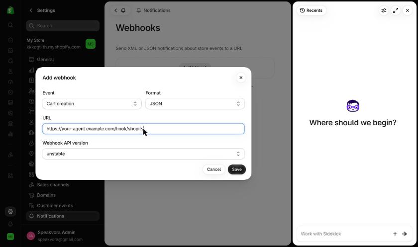

4. Back in the agent dashboard paste the secret from step 2 into **Webhook signing secret from Shopify**.

   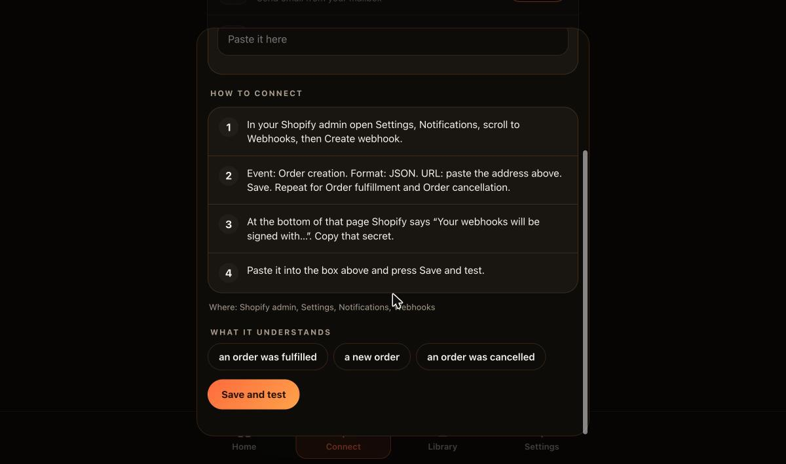

5. Press **Save and test**. When the first order event arrives the card turns to Connected.

What it understands: an order was placed, fulfilled or cancelled. The agent checks Shopify's signature on every message and ignores anything that fails it.

Tested for real: signed delivery from Shopify's own "Send test" reached an agent and started a workflow in practice mode. Not yet tested: a real customer order ending in a real text message.

## GitHub

1. In the dashboard open **Connect**, then **GitHub**. Copy **Your address** and **Secret**.

   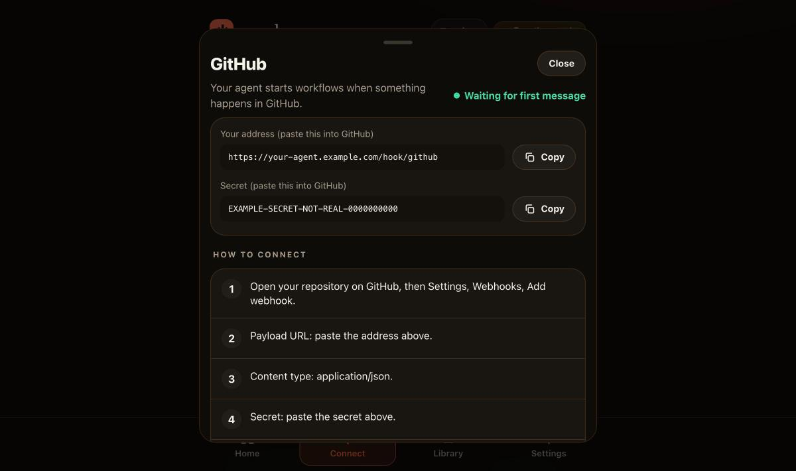

2. On GitHub open your repository, **Settings, Webhooks, Add webhook**. Paste the address into **Payload URL**, set **Content type** to `application/json`, paste the secret into **Secret**.

   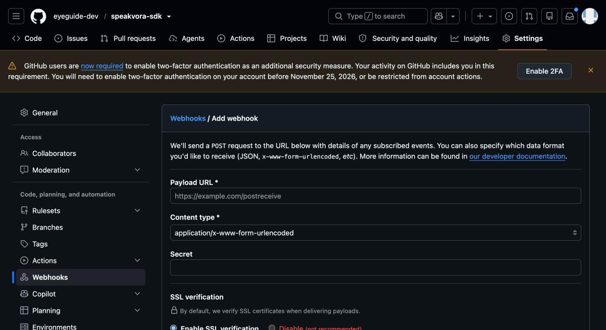

3. Under "Which events would you like to trigger this webhook?" choose **Let me select individual events** and tick what you want (workflow runs, pull requests, issues, releases), keep **Active** ticked, then press **Add webhook**.

   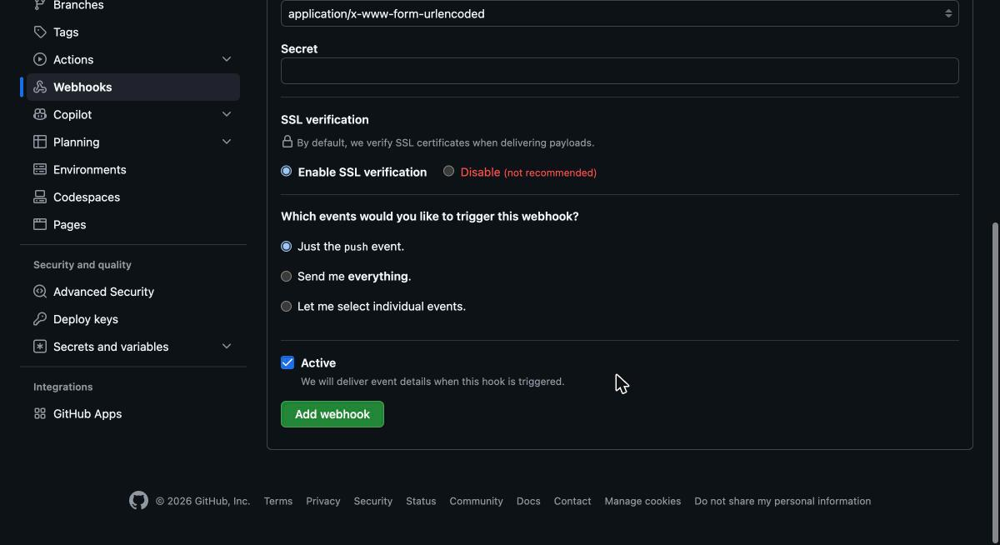

4. GitHub sends a ping straight away. The dashboard card turns to Connected when the first real event arrives.

GitLab works the same way (Settings, Webhooks), with its own card in the dashboard.

## Slack and Google Calendar

* Slack: [setup-services.md](setup-services.md). On api.slack.com open your app, **Incoming Webhooks**, **Add New Webhook to Workspace**, pick a channel, and copy the Webhook URL (shown here as a fake example):

  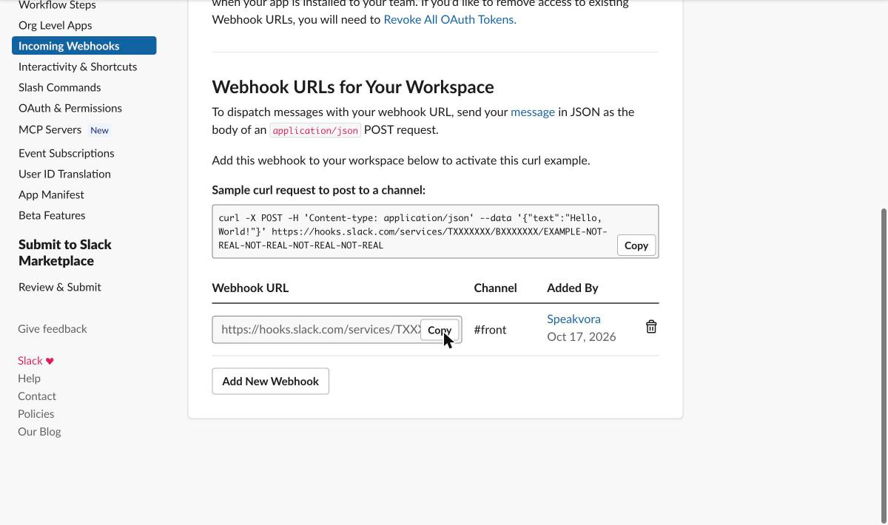

  Then paste it in the dashboard:

  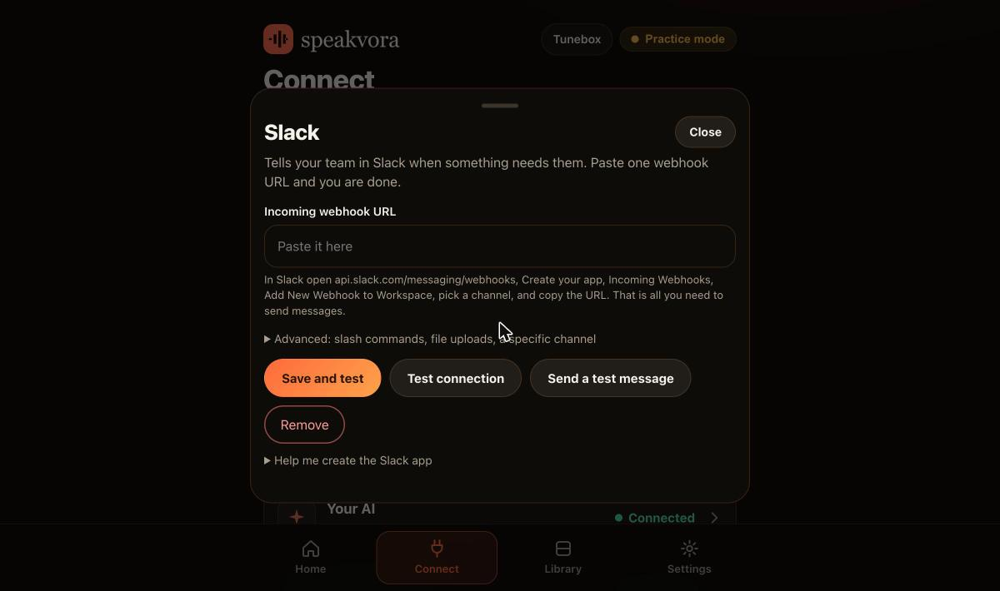

* Google Calendar (the screens below come from a throwaway test account; addresses are blurred): [google-calendar.md](google-calendar.md).

  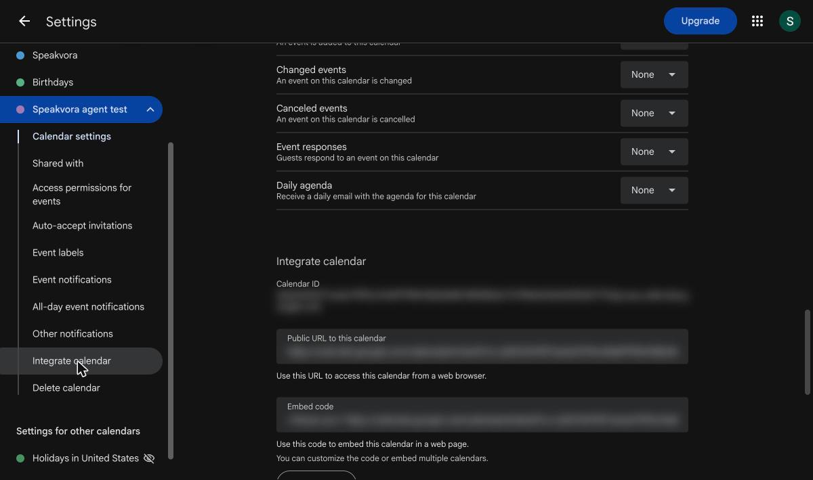

  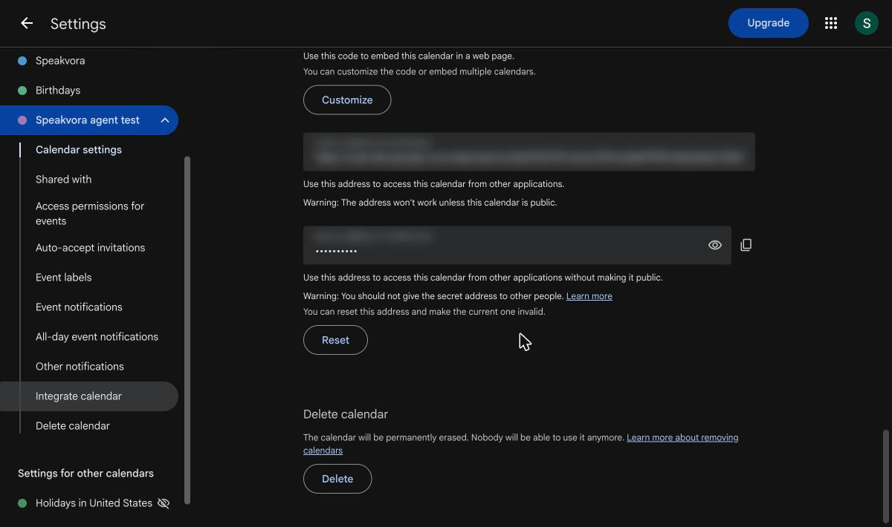

  Paste your calendar's secret iCal link to read bookings, or use the OAuth fields to let the agent create, move and cancel events:

  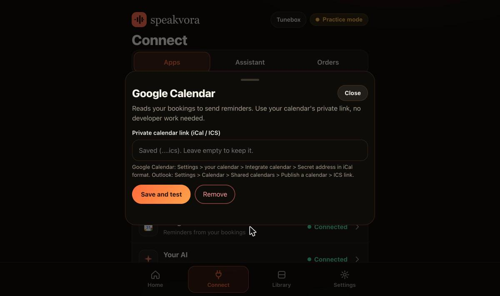

All your connected apps appear in one list:

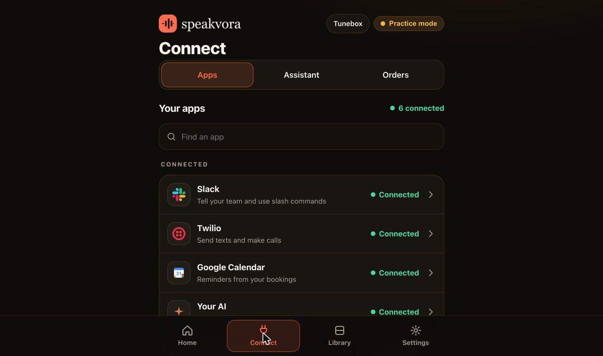
