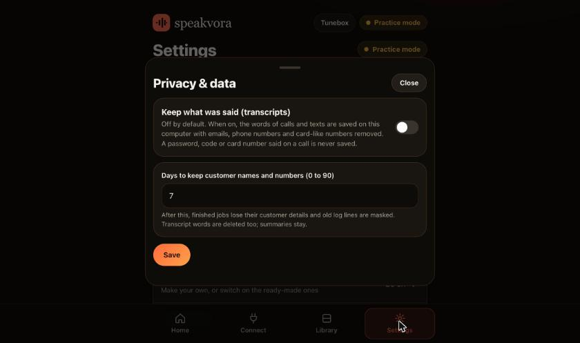

# You control the limits

*Screens come from a throwaway test setup; addresses and secrets shown are fake examples.*

`agent.json` has a `mode` that sets how tightly the agent limits itself. Any single value can still be overridden.

| Mode | Per person per day | Per hour (all) | Quiet hours (texts and calls) |
|---|---|---|---|
| `strict` | 2 | 30 | 8 PM to 9 AM |
| `standard` (default) | 3 | 60 | 9 PM to 8 AM |
| `open` | no limit | no limit | none |

Set `"limits": {"per_recipient_per_day": null, "per_hour": null}` for no limit on one of them, or any number you like. `quiet_hours` can be `{"applies_to": []}` to turn them off, or your own window and timezone.

## Consent
By default customer messages need consent from your app, calendar notes or source mapping (`customer.sms_consent`). People who contact you first can always be answered. You can add trusted numbers in `recipients.allow`. If you have your own consent records you may set `"consent": {"required": false}`; that is your responsibility.

## What can never be switched off
* **STOP / opt-out** is always honoured.
* **Required lines** for your industry are always said or texted (see `your-industry.md`): "This is an automated call.", the opt-out footer on texts, and the notices your industry needs. If the pack does not have the audio for one yet, the agent says the same words in the phone provider's voice and logs it.
* **The kill switch** (a file named `STOP` in `agent-state/`).
* **Signatures** on every inbound request.

## Extra required lines
Add your own: `"compliance": {"extra_required": [{"slot": "confidentiality_notice", "applies": ["call_out", "sms"]}], "recording": true}`. `recording: true` says "This call may be recorded and monitored." at the start of every call. `sms_footer` can be `"first"` (default: the opt-out footer once per person) or `"always"`.

## Dry-run, allow-lists, logs
`--live` or `"dry_run": false` is the only way to send. Everything the agent does or refuses (with the reason) is in `agent-state/agent.log.jsonl`.

## Opt-outs also stop calls
When a person texts STOP (or the pack language's word for it), the agent stops both texts and calls to that number until they opt in again. This is on purpose and cannot be switched off. Twilio also keeps its own STOP list for your number; a person who texted STOP to your Twilio number must reply START to Twilio before any text reaches them.
