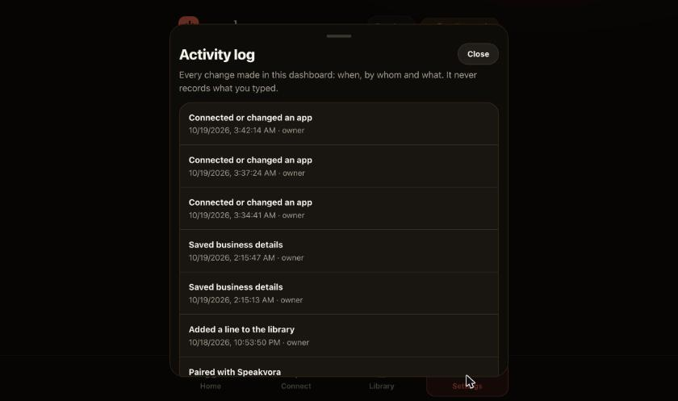
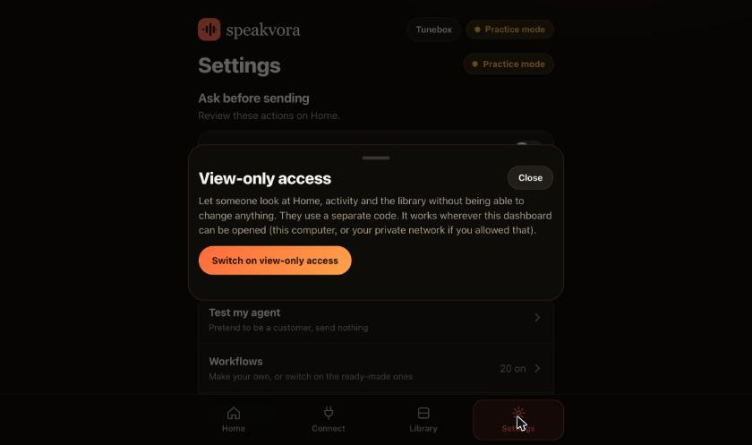

# Activity log and view-only access

*Screens come from a throwaway test setup; addresses and secrets shown are fake examples.*

Two small controls for businesses where more than one person looks at the dashboard. Both are in **Settings**.

## Activity log: who changed what
**Settings, Activity log** lists every change made in the dashboard, newest first: when, who (owner or view-only user) and what, in plain words ("Saved a workflow", "Approved a message", "Switched sending mode", "Connected or changed an app").
* It never records what you typed, so keys, messages and customer details never land in it.
* Looking around, previews and **Test my agent** are not changes and are not logged.
* It is a file on your computer (`agent-state/audit.jsonl`) that keeps the last 5,000 entries. It is for your own records and is not tamper-proof.

## View-only access
**Settings, View-only access, Switch on.** You get a separate code. Someone who opens the dashboard with that code (the same address, ending `#token=` followed by the view-only code) can see **Home, activity and the library**, but cannot change anything: every approve, save, connect or pause is refused with "You have view-only access", and Connect and Settings are hidden.
* **Make a new code** ends the old one at once. **Switch off** removes view-only access.
* It works wherever the dashboard itself can be reached: this computer, or your private network if you allowed that (`"dashboard": {"allow_remote": true}` in agent.json). It is not a public link.
* What a view-only user can see includes customer messages shown on Home. Give the code only to people who may see them.
